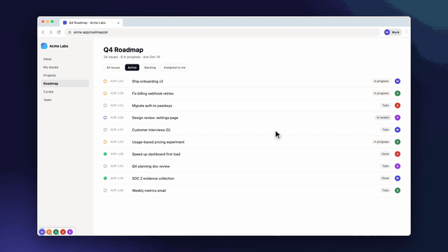
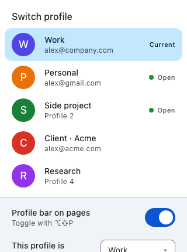

# Profile Switcher

Arc-style, one-click switching between Google Chrome profiles.

A small row of profile pictures sits in the bottom-left corner of every page. Click one and
you're in that profile. A green dot means the profile is already open, and switching to it is
instant.





## Features

- **Profile bar on every page**: about 30px tall, bottom-left, where most sites leave space.
  Hover a picture to see the profile's name.
- **Toolbar popup** listing every profile with its name and email.
- **Keyboard shortcuts**: `⌥⇧P` shows or hides the bar, and `⌥⇧.` / `⌥⇧,` go to the next or
  previous profile. Change them at `chrome://extensions/shortcuts`.
- **Always up to date**: new, renamed and deleted profiles show up on their own, because the
  list is read from Chrome's `Local State` each time it's shown.
- Light and dark mode, Material 3 styling, no tracking, no network requests.

## Requirements

macOS, Google Chrome 120 or newer, Python 3 (the one that comes with the Xcode command line
tools works), and Node.js 18+ to build.

## Install

```sh
git clone https://github.com/valentinsystemsone/chrome-profile-switcher.git
cd chrome-profile-switcher
npm install
npm run build      # builds the extension into dist/
./install.sh       # installs the small native helper (see below)
```

Then, in **each** Chrome profile you want to switch between:

1. Open `chrome://extensions` and turn on **Developer mode**.
2. Click **Load unpacked** and pick the `dist/` folder.
3. If the profile isn't signed in to a Google account, open the extension's popup once and set
   **This profile is**. Signed-in profiles are detected by email.

The extension ID is always `aklnhhcndpmbcflhafohkcocepmdepao` (it's fixed by the `key` in the
manifest), so the helper recognises it in every profile.

To uninstall, run `./uninstall.sh`, then remove the extension in each profile.

## How it works

A Chrome extension can't do this on its own. Each profile runs a separate copy of every
extension, and those copies can't see or talk to each other. No extension API can list your
profiles or open a window in another one.

So a small Python helper ([`host/host.py`](host/host.py), standard library only) runs through
Chrome's [native messaging](https://developer.chrome.com/docs/extensions/develop/concepts/native-messaging):

- It reads the profile list and pictures from
  `~/Library/Application Support/Google/Chrome/Local State`.
- Each profile's copy of the extension keeps one helper running, which listens on a socket in
  `~/.chrome-profile-switcher/sockets/`.
- To switch to a profile whose helper is running, it asks that helper to bring its window
  forward. That's the instant switch, shown by the green dot.
- Otherwise it runs `Google Chrome --profile-directory="Profile N"`, which opens a window in
  that profile in about a second.

`install.sh` copies the helper to `~/.chrome-profile-switcher/` and registers it with Chrome.
Re-run it after editing `host/host.py`.

## Development

```
src/            TypeScript sources: background service worker, content script (the bar), popup
public/         Static files copied as-is: manifest, popup HTML/CSS, icons
host/host.py    Native messaging helper
dist/           Build output (load this in Chrome)
```

- `npm run build` bundles with [esbuild](https://esbuild.github.io/) into `dist/`.
- `npm run watch` rebuilds on save. Click reload on `chrome://extensions` to pick up changes.
- `npm run typecheck` runs strict TypeScript checks.

The styling is plain CSS using Material 3 design tokens (Google's GM3 palette, the one Chrome
uses). There's no UI framework. The icons are drawn by `make_icons.py`.

## Limits

- macOS and Google Chrome only. The paths are hard-coded in `host.py` and `install.sh`.
  Pull requests for Linux, Windows or other Chromium browsers are welcome.
- A profile whose window is closed stays loaded only while Chrome keeps it in memory.
  Switching to it then opens a new window.
- The bar doesn't appear on `chrome://` pages or the Chrome Web Store. Use the popup or the
  shortcuts there.

## License

[MIT](LICENSE)
